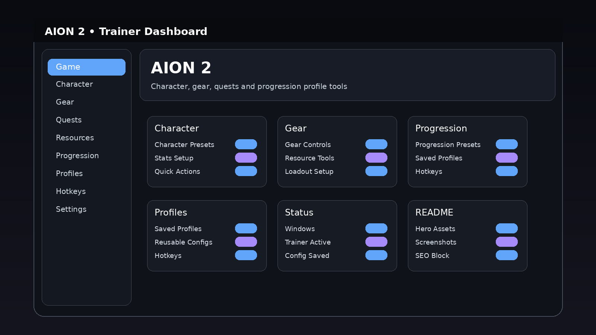

# AION 2 Trainer — Configurable Profiles & Hotkeys for Windows 10/11

   

---

AION 2 Trainer is a Windows desktop tool built for players who want their setup dialed in without friction. It pairs reusable profiles with configurable hotkeys, so you configure once and load the same layout whenever you need it. A game-specific dashboard keeps every option grouped where you expect it, and saved presets let you switch configurations fast between sessions. Everything runs from a single desktop interface on Windows PC.

## Features

### Character

- **Character Presets** — swap between saved character configurations instantly, no rebuild from scratch each session.
- **Stats Setup** — tune stat allocations per profile and keep multiple arrangements ready to load.
- **Quick Actions** — trigger common character tasks from one dashboard panel instead of digging through menus.

### Gear

- **Gear Controls** — manage equipment-related options in a dedicated panel, grouped for fast access.
- **Resource Tools** — keep resource-related settings organized and reusable across sessions.
- **Loadout Setup** — build and store loadouts so your preferred setups are always one click away.

### Progression

- **Progression Presets** — save progression-oriented configurations and reload them whenever you need the same run.
- **Saved Profiles** — every profile persists to disk; name it, reuse it, and stop reconfiguring on every launch.
- **Hotkeys** — bind any action to a configurable key so toggles happen mid-session without a trip back to the UI.

### Compatibility

- **Platform:** Windows PC only
- **Interface:** Desktop dashboard built around the AION 2 layout
- **Profiles:** Supported — save, name, and reload
- **Hotkeys:** Fully configurable per profile
- **Presets:** Supported across character, gear, and progression options

## How It Works

AION-2-Trainer runs as a native Windows desktop dashboard built around one idea: set it up once, reuse it forever. The app launches as a standalone overlay-style panel that sits alongside the game, so you're never alt-tabbing through menus mid-session.

Everything flows through profiles. The trainer ships with base configurations for character, gear and progression work, and each one loads its full option set instantly. Tweak any value, and the dashboard updates live — no restarts, no reloads. When a setup feels right, save it as a named profile and it stays ready for the next session.

Hotkeys are fully configurable. Bind any option group to a key combo and trigger it without leaving the game window. The trainer tracks your bindings and keeps them separate per profile, so a progression setup and a utility setup can share the same keyboard without stepping on each other.

Under the hood, the dashboard keeps option groups isolated — character tools, gear controls and progression presets each live in their own panel, and changes apply only to the active profile. That means switching profiles is clean: load a saved setup and the full configuration snaps into place exactly as you left it.

The whole loop is short: launch, pick a profile, adjust, save. Repeatable, predictable, and built to stay out of your way while you play.

## Supported Games

AION 2 Trainer is built for one target and tuned for it: **AION 2** on Windows PC. No bloat, no half-supported side projects — just a dashboard that matches the game it's made for.

**AION 2 (Windows PC)**
The primary and fully supported target. Every profile, preset, hotkey slot and dashboard element in the trainer is designed around AION 2's character, gear and progression systems. If you're playing AION 2 on Windows, this is the configuration the trainer ships for out of the box.

**What "supported" means here**
- Profiles and presets are mapped to AION 2 gameplay categories — character, gear, progression — not generic placeholders.
- Configurable hotkeys are laid out for the AION 2 dashboard flow.
- Dashboard visuals are game-specific, so the interface reads like it belongs to AION 2, not a reskinned generic tool.

**Platform baseline**
Windows PC only. The trainer is a desktop utility — no browser build, no mobile version, no console support. Profiles and hotkeys are saved locally and reload on launch, so your AION 2 setup carries over between sessions.

**One game, done right**
The trainer doesn't spread itself across a dozen titles. AION 2 is the supported game — and the whole tool is built around making that one experience cleaner, faster and more repeatable.

## Configuration

Everything in AION-2-Trainer is built to be tuned. No buried config files, no guesswork — profiles, hotkeys and presets are all exposed in the dashboard and saved between sessions.

**Reusable profiles** are the core of the setup. Dial in a configuration once, save it under a name, and reload it whenever you want that exact state back. Keep a default baseline, a gameplay profile, a progression-oriented setup and a utility profile on hand, or build custom profiles for whatever you're running. Switching between them is instant.

**Configurable hotkeys** let you bind the actions you use most to the keys you actually want. Rebind freely, keep separate bindings per profile if your sessions call for different layouts, and the trainer remembers your choices on the next launch.

**Session presets** cover the quick-change case — preset groupings for character, gear and progression options so you can flip a whole category on or off without touching it item by item.

Configuration lives in the dashboard itself. Select a profile, adjust the options, save. That's the whole loop. Saved configurations persist locally on your Windows PC alongside the application, so your setup is waiting the next time you open the trainer.

## FAQ

**What do I get in the current package?**

The full Windows trainer: a game-specific dashboard, reusable profiles, presets, and configurable hotkeys — all in one desktop app. Everything is built around AION 2, so the option groups match the game's systems instead of a generic overlay.

**Which platforms are supported?**

Windows PC only. The trainer is a desktop application and won't run on consoles, mobile, or non-Windows operating systems.

**Do I need to install anything extra?**

No dependency installs or package managers. Extract the package to a folder on your PC and launch the application — that's it.

**Are my settings saved between sessions?**

Yes. Configuration is handled through profiles. Set up your options for a session, save them as a profile, and load that profile again whenever you want the same setup. The default, gameplay, progression, utility, and custom presets cover the common cases out of the box.

**Can I change the hotkeys?**

Yes. Hotkeys are fully configurable, so you can map the actions you use most to keys that fit your setup.

**Is it hard to switch between different configurations?**

Not at all. The whole workflow is profile-driven: pick a relevant profile, tweak options for the current session, and save. Switching back later is a single load action — no re-configuring from scratch.

**Does it work with any other games?**

No. The dashboard visuals and option groups are specific to AION 2. It's built as a game-specific trainer, not a one-size-fits-all tool.

**What's the interface like?**

A desktop dashboard organized around quick configuration: game-specific option groups, a detail panel for the selected profile, and fast access to saved presets and quick actions. Clean layout, no clutter.

**Where do I grab the latest version?**

Use the Download buttons on this page to open the download page, then grab the current Windows package. That's always the version you want — no separate updater to hunt down.

## Disclaimer

AION-2-Trainer is a desktop utility built for offline profile management and single-player experimentation. It is not affiliated with, endorsed by, or sponsored by the developers or publishers of AION 2, and it does not modify, inject into, or interact with official game clients or servers. Use it at your own risk. You are responsible for how you configure profiles, presets, and hotkeys, and for complying with the terms of service of any software you run alongside it. The project is provided as-is, without warranty of any kind, and the maintainers accept no liability for account actions, data loss, or system issues arising from misuse. Keep your profiles backed up, test changes in a safe environment first, and don't expect the trainer to do anything it wasn't designed to do.

